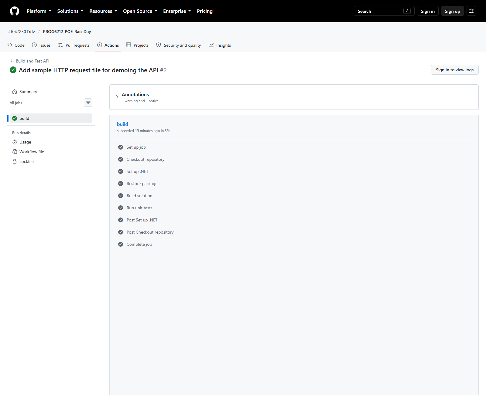

# RaceDay

RaceDay is a web-based event management system for South African road running, walking, and cycling events. The platform lets Organisers create and manage events, while Participants can browse, enter events, and track their results.

## System Description

South Africa has a big road events culture, from the Comrades Marathon to the Cape Town Cycle Tour and hundreds of community runs every weekend. Most of these events are still run with paper registration and spreadsheets. RaceDay aims to fix that by giving organisers and participants one place to manage everything.

The system supports two user roles:

### Organiser
- Create, edit, and delete events
- Set up event categories (like 5km, 10km, 21km, 42km)
- Capture and manage participant results
- View all event enrolments

### Participant
- Create an account and log in
- Browse upcoming events
- Enter an event by selecting a category
- View their own enrolments
- Track their personal results and finish times

## Project Structure

```
RaceDay-POE/
├── docs/
│   ├── ERD.md                    # Entity Relationship Diagram with Mermaid code
│   ├── ERD.png                   # Rendered ERD image
│   ├── API-Endpoint-Plan.md      # Full API endpoint specification
│   ├── API-Endpoint-Plan.docx    # Word version of the API plan
│   └── RaceDay-Database.sql      # SQL Server script to create and seed the database
├── RaceDay.API/                  # Part 2: the ASP.NET Core Web API
│   ├── Controllers/              # Auth, Users, Events, Categories, Enrolments, Results
│   ├── Data/RaceDayContext.cs    # EF Core mapping onto the SQL script's tables
│   ├── Models/                   # The six entities from the ERD
│   ├── Auth/SessionAuthAttribute.cs   # Small filter: no session = 401, wrong role = 403
│   └── Security/PasswordHasher.cs     # PBKDF2 password hashing
├── RaceDay.API.Tests/            # xUnit tests (run against an in-memory database)
├── RaceDay.slnx                  # Solution with both projects
├── .github/
│   └── workflows/
│       ├── validate-docs.yml     # Checks the Part 1 docs exist and look right
│       └── build-api.yml         # Builds the API and runs the tests on every push
├── generate-docx.js              # Script to generate the Word document
├── package.json                  # Node.js dependencies for docx generation
└── README.md
```

## Database

The database has 6 tables:

1. **Users** - All user accounts (Organisers and Participants)
2. **OrganiserDetails** - Extra info for Organiser users
3. **Events** - All races and events
4. **Categories** - Distance categories for each event
5. **Enrolments** - When participants sign up for a category
6. **Results** - Finish times and positions after events

To set up the database:
1. Open SQL Server Management Studio (SSMS)
2. Connect to your SQL Server instance
3. Open the file `docs/RaceDay-Database.sql`
4. Run the script - it creates all tables and adds sample data
5. The script can be re-run safely (it drops tables first if they exist)

The seed data includes:
- 2 Organisers (Thabo and Nadia) with their club details
- 2 Participants (Sipho and Emily)
- 3 Events (Soweto Marathon, Cape Town Cycle Tour, Comrades Marathon)
- 7 Categories across the 3 events
- 6 Enrolments (3 per participant)
- 3 Results from the Soweto Marathon

Note: the seeded users keep the placeholder password hashes from Part 1, so they cannot be used to
log into the API. Register a new account through the API instead.

## Part 2 — The REST API

The API implements every row of `docs/API-Endpoint-Plan.md` (22 endpoints).

### How to run it

1. Create the database first (see the Database section above) — the API maps onto those tables.
2. Check the connection string in `RaceDay.API/appsettings.json`. It is set to
   `Server=localhost\SQLEXPRESS;Database=RaceDayDB;Trusted_Connection=True;TrustServerCertificate=True;`
   (Windows auth). Change the server name if your SQL Server instance has a different one.
3. From the repo root run:
   ```
   dotnet run --project RaceDay.API
   ```
4. Open the Swagger UI in a browser: **http://localhost:5220/swagger**
   Every endpoint can be tested there. Register an account, log in through
   `POST /api/auth/login` (this sets the session cookie), then the protected endpoints work.
5. Run the unit tests with:
   ```
   dotnet test RaceDay.slnx
   ```
   The 31 tests use an in-memory database, so they run without SQL Server installed — the same
   reason CI on GitHub can run them.

### Design notes

- **Code-first model, no EF migrations.** The schema and seed data come from the Part 1 SQL script,
  so the database matches the ERD exactly. The entity classes and `RaceDayContext` only map onto
  those tables (keys, unique constraints, defaults, check constraints and delete rules mirror the
  script). If the schema ever changes, edit the script and the entities together.
- **Server-side sessions, not JWT.** Login stores the user's ID and role in the session on the
  server and sends a session cookie. `SessionAuthAttribute` protects the endpoints: no session
  returns 401, the wrong role (or someone else's data) returns 403.
- **Passwords are hashed** with PBKDF2 (SHA-256, 100 000 iterations, random salt per user) and
  compared in constant time. Plain passwords are never stored or logged.
- **Errors follow one pattern everywhere:** 400 bad body, 401 not logged in, 403 wrong role or not
  the owner, 404 missing id, 409 duplicate enrolment / full category / duplicate result.

## Plan Changes (added during Part 2)

The Part 1 plan stayed as the specification for the API. Four things were added to `docs/API-Endpoint-Plan.md` before any code was written, and three of them come straight from the brief's functional requirements:

- `GET /api/events/{eventId}/enrolments` - the brief says Organisers must be able to view all enrolments for their events.
- `GET /api/users/results` - the brief says Participants must be able to view their own results.
- `POST /api/auth/logout` - sessions need a way to end.
- The login entry now describes a server-side session (the server stores the user ID and role) instead of a JWT, because that is what Part 2 requires.

The `Events` table in `docs/RaceDay-Database.sql` also gained `Distance` and `EventType` columns, and the ERD was updated to match, because the brief says every event must capture a distance and an event type (run, walk or cycle). Total endpoints: 19 -> 22.

## CI/CD

Two GitHub Actions workflows run on every push:

- `.github/workflows/validate-docs.yml` (Part 1) checks that the docs folder, ERD, API plan, SQL script and README exist and that the SQL script really contains tables and seed data.
- `.github/workflows/build-api.yml` (Part 2) sets up .NET 10, restores and builds `RaceDay.slnx`, and runs all 31 unit tests on the GitHub runner (which has no SQL Server, so the tests use the in-memory database).

### CI Build Status



## Video Presentation

The video covers:
- Running the API and a tour of the Swagger UI
- Registering and logging in as an Organiser and as a Participant
- What happens when a role rule is broken (401 and 403 responses)
- A walkthrough of one controller and how it maps to the endpoint plan
- Running `dotnet test` and showing all tests pass
- Walkthrough of the ERD and the API endpoint plan (Part 1)

### Video Requirements
- Must be unlisted on YouTube
- Must include voiceover explaining the code structure and design decisions
- Must show the running application
- No AI-generated voices are allowed
- Video link must be included in this README

## References

- Connolly, T. and Begg, C. (2015) *Database Systems*. 6th ed. Harlow: Pearson.
- Microsoft (2026) ASP.NET Core web API documentation. Available at: https://learn.microsoft.com/en-us/aspnet/core/web-api/ (Accessed: 22 September 2026).
- Mermaid (2026) Entity Relationship Diagrams. Available at: https://mermaid.js.org/syntax/entityRelationshipDiagram.html (Accessed: 22 September 2026).

## AI Use Disclosure

As required by the brief, I disclose the parts of this project where AI tools were used:

- **Proofreading and wording:** AI was used to check grammar and tighten up wording in the README and planning documents.
- **Document formatting:** AI helped with the layout of the API endpoint table and with generating the Word version of the endpoint plan (`generate-docx.js`).
- **Mermaid syntax:** AI helped fix a syntax error when rendering the ERD diagram to PNG.
- **Part 2 API code (new):** AI helped draft the controller, model, filter, hashing and test code and helped debug two issues (the OrganiserDetails primary key and swapping the database provider in the test factory). I decided the design myself — the session-based auth instead of JWT, the PBKDF2 password hashing, the role and ownership rules, the error codes and the test list — based on the brief and the plan. I ran every endpoint live against the database (35 end-to-end checks) and ran the test suite before every commit, and I reviewed the code and the plan row by row before committing it.

All design decisions are my own: the choice of the six entities and their attributes, the relationships and cardinality, the API routes and role rules, the SQL constraints, and the seed data. I reviewed and tested everything before committing.

---

**Student:** Yadav Iserbelas
**Student Number:** st10472501
**Module:** PROG6212 Programming 2B
**Date:** October 2026
